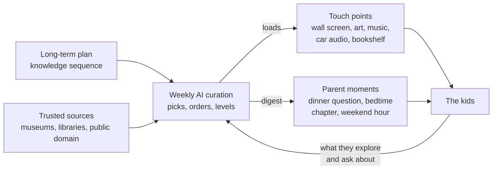

# Quark

*"A way a lone a last a loved a long the riverrun, past Eve and Adam's, from swerve of shore to bend of bay, brings us by a commodius vicus of recirculation back to Howth Castle and Environs." — James Joyce, Finnegans Wake, its last line running into its first. The book that gave physics the word "quark" is a circle: it ends where it begins, and each pass through it goes a little deeper.*

**An open project to build Quark, an AI tutor that helps parents give their kids a rich, challenging education at home, even when parents are short on time.**

> Status: being built for one family first; the foundation and values interview are done, the weekly curation engine is in progress on a branch (it builds a trial day of cards that mixes the first theme with short lessons, shows parents what it costs, and checks every card against the family's rulebook and a safety floor before a child could see it; that check works on a test copy and is not on the family's copy yet), nothing is on the kids' iPads yet, and we're looking for parents, educators, designers and developers to help. Current detail: the Where we are note in CLAUDE.md.

## The idea in one paragraph

Most of the world's great art, music, literature, science and history is online and free, but almost nothing organizes it for children. Busy parents can't do that work, and schools, especially underserved ones, often don't. This project uses an AI that has read essentially everything to do the slow parts: follow a multi-year plan, choose the best existing material for each child's age and interests, and deliver it through a few touch points in the home. Parents set the direction. The tutor does the legwork, and what the kids explore feeds back into what comes next.

## Read the concept

| Page | What's in it |
| --- | --- |
| [Vision and goals](docs/01-vision.md) | The problem and what success looks like |
| [How it works](docs/02-how-it-works.md) | The tutor, its parts and the weekly loop |
| [Touch points](docs/03-touch-points.md) | Where kids and parents meet the material |
| [Curation engine](docs/04-curation-engine.md) | Long-term plan, weekly cycle, adapting to each child |
| [Lenses](docs/17-lenses.md) | The seven doors into a theme, and how the tutor picks which one opens first |
| [Teaching that tests itself](docs/12-teaching-that-tests-itself.md) | Every lesson is also a measurement; the evidence comes from the kids it teaches |
| [Reward engine](docs/15-reward-engine.md) | Whether and how to reward effort without hollowing out the learning. Needs a deep dive. |
| [Resources](docs/05-resources.md) | Free, high-quality material to build on |
| [Design principles](docs/06-design-principles.md) | Competing for attention without manipulation |
| [Safety and privacy](docs/07-safety-and-privacy.md) | Non-negotiables for a product used by children |
| [Architecture and tech stack](docs/13-architecture.md) | The five layers, what we build versus reuse, and the decisions that shape it |
| [Visions and evidence](docs/11-visions-and-evidence.md) | The futurists and research we build on, and the principles they give us |
| [Prior art and building blocks](docs/10-prior-art.md) | What already exists, what we can reuse, and content licenses |
| [Values packs](packs/README.md) | The controversial points, the first communities, and the pack format. Packs live in `packs/`. |
| [Values packs: prior art](docs/16-values-packs-prior-art.md) | What AI alignment, media ratings, homeschool labels and education law already define, and what we borrow |
| [Hosting and privacy](docs/14-hosting-and-privacy.md) | Where a family runs its copy, and why one family per copy keeps privacy law simple |
| [Family beliefs and values](docs/09-family-values.md) | Letting parents state their beliefs openly and shape how sensitive topics are taught |
| [Open questions](docs/08-open-questions.md) and [board](docs/board.md) | What we haven't figured out yet, and where every feature stands |

## Founding rules on beliefs

1. **This is not a brainwashing engine.** Families shape framing and timing. Kids still learn how to think, learn that others believe differently, and are never manipulated.
2. **Every guardian has an equal say.** Every guardian who actively configures the tutor has equal weight in its values. Any one guardian can blackball a topic, and the tutor stays silent on it. A short safety floor can't be blocked.

See [Family beliefs and values](docs/09-family-values.md).

## How to help

You don't need to write code. We need:

- **Parents** to say what would actually work in their homes.
- **Teachers and homeschoolers** to shape the long-term plan and the age-level guidance.
- **Designers** to sketch the wall screen and the parent digest.
- **Developers** to prototype the curation engine and the kid-facing app.
- **Anyone** to suggest great free resources.

Start with [CONTRIBUTING.md](CONTRIBUTING.md), or open an issue or discussion.

## License

Documentation is licensed under [CC BY 4.0](https://creativecommons.org/licenses/by/4.0/). Code, when there is some, is under the [MIT License](LICENSE).
