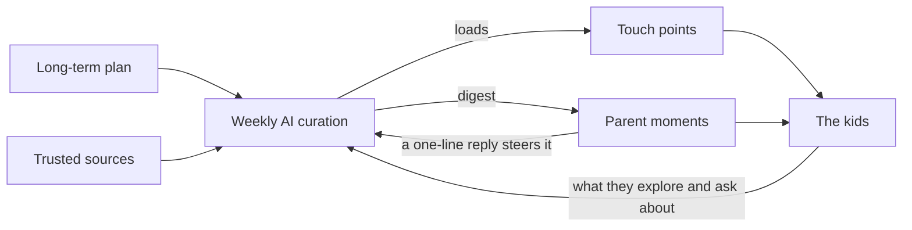

# How it works

The AI tutor works for parents. It plans what kids learn over the long run, picks the best existing material, and delivers it through a few touch points around the house. Parents set the direction, and the tutor does the legwork.

The AI covers what parents lack: time, and knowing what's out there. It can do the slow parts:

- Find the best painting, piece of music, book chapter or experiment for a given topic and age.
- Order them so each week builds on the last.
- Adjust the difficulty for each child.
- Notice what lights a child up and follow it.

## Two delivery paths

- **On their own:** touch points in the home, like a wall screen, car audio and the bookshelf. See [Touch points](03-touch-points.md).
- **Through parents:** short, ready-made moments, like a dinner question, a bedtime chapter or a weekend outing.

## The loop

What the kids explore and ask about feeds back into next week's plan. That keeps it alive without anyone having to manage it.

## Main parts

| Part | Job |
| --- | --- |
| Curation engine | Plans, selects, levels and schedules content. See [Curation engine](04-curation-engine.md). |
| Wonder Wall | A kid-facing touchscreen for self-directed exploration |
| Parent digest | A weekly summary and plan, plus a simple way to steer |
| Ask | A kid-safe question box, answered at the child's level and logged for parents |
| Content library | Approved sources and the items pulled from them. See [Resources](05-resources.md). |
