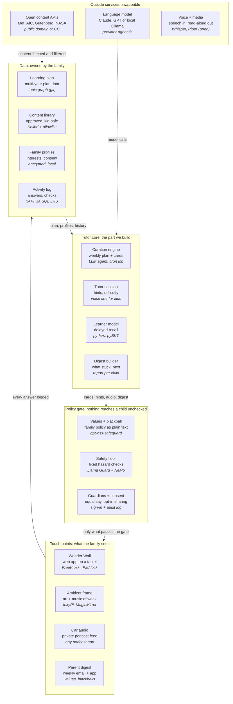

# Architecture and tech stack

We build two things: the tutor core and the policy gate. Everything else is an existing open-source part or a swappable outside service. The data stays with the family.



The core writes cards, hints and the digest. Every one of them passes through the policy gate before a child sees it. Everything a child does is logged, and the core reads that log, the plan and the profiles to decide what comes next. Outside services are behind interfaces so any of them can be replaced.

## What each layer needs

| Layer | What we need to decide | Likely choices |
| --- | --- | --- |
| Touch points | A kid-facing web app that works on a locked tablet, with voice. An ambient display. Audio that reaches the car without a special app. A parent interface. | One web app (React or Svelte) in FreeKiosk or iPad Guided Access. InkyPi or MagicMirror² for the frame. A private RSS podcast feed for the car. Parent digest by email, plus a small web app for settings. |
| Policy gate | Turn a family's values profile into something a machine can enforce. A fixed safety floor nobody can switch off. Guardian sign-in with equal weight and a full audit trail. | gpt-oss-safeguard with the profile as its policy. Llama Guard 4 for the floor, NeMo Guardrails around the Ask box. A simple auth system (for example Keycloak or Auth.js) with every decision logged. |
| Tutor core | The weekly curation job, the live tutoring session, the learner model and the digest. This is the orchestrator and most of the project's own code. | Python (FastAPI) services. A scheduled job for curation. py-fsrs and pyBKT for the learner model. Prompts and teaching rules kept as versioned files so the community can improve them. |
| Data | The multi-year plan as data, the approved content library, family and child profiles, and the activity log. | The plan as a topic graph in the repo (JSON or YAML, versioned in git). Kolibri or a plain database for content. Postgres or SQLite for profiles, encrypted at rest. SQL LRS (xAPI) for the log, so the data is portable. |
| Outside services | Content sources, the language model, and speech. All swappable. | Open content APIs (Met, AIC, Gutenberg, LibriVox, NASA, PhET). A model adapter so families can use Claude, GPT or a local Ollama model. Whisper for speech-to-text, Piper or Kokoro for read-aloud. |

## Decisions that shape everything else

- **Local-first or hosted.** A family can run the whole thing on a home server or a small computer like a Raspberry Pi, with only model calls leaving the house. A hosted version is easier for most families but makes the project responsible for children's data. The design should allow both, starting local-first.
- **Cost of model calls.** The weekly curation job and the tutoring sessions are the main costs. Pre-generating cards once a week and caching them keeps it to a few dollars a month per family. Live sessions can run on a cheaper or local model.
- **Offline by default.** The wall should work with no internet. Cards, audio and images download once a week. The Ask box is the only live piece.
- **Children's privacy law.** Any hosted version must meet COPPA in the US and similar laws elsewhere. Local-first avoids most of this, which is another reason to start there.
- **Content pipeline and licensing.** Every item in the library carries its source and license, and goes through the allowlist before a child can see it.
- **Portability.** Standard formats (xAPI, H5P, a documented plan format) so a family can leave with their data, and so other tools can plug in.

## A minimal single-family stack

The full architecture above is the community vision. One family can start much smaller, on hosted services most developers already know. This is the stack the first family is building on.

| Piece | Minimal version | Replaces in the full architecture |
| --- | --- | --- |
| Kid and parent apps | One web app on Vercel (or Netlify, Cloudflare Pages). The tablet opens the kid view, parents open the settings view. | Separate kid and parent apps |
| API | Serverless API routes alongside the app | FastAPI services |
| Database, auth, files | Supabase: tables for profiles, values and blackballs, cards, activity and check results. Supabase Auth for guardians. Storage for images and audio. | Postgres, Keycloak, Kolibri, SQL LRS |
| Weekly curation job | A scheduled (cron) function once a week. If it outgrows the function time limit, a small worker on Railway or Fly.io. | Scheduled job in the core |
| Language model | A model provider API key (Anthropic, OpenAI or similar) | Model adapter |
| Policy check | A second model call that checks each card against the written values profile before it's saved | gpt-oss-safeguard, Llama Guard |
| Digest | A transactional email service (Resend or similar) | Digest service |
| Voice | The tablet browser's built-in speech recognition and read-aloud | Whisper, Piper |
| Car audio | An RSS file in storage. Any podcast app subscribes. | Same |
| Tablets | iPads in Guided Access, or Android tablets in FreeKiosk, pointed at the app URL | Same |
| Code | GitHub, deploying on push | Same |

**Left out for one family:** Kolibri, the xAPI log server, the knowledge-tracing libraries, Keycloak and local models. Database tables do the job for one household.

**Rough cost:** hosting on free or lowest tiers, plus model usage. About $5–20 a month, depending on how much kids use the Ask box.

**What version one actually uses.** Everything is TypeScript in one Next.js app at the repo root, not Python services. The code lives in `app/` (the `/kid` and `/parent` views and the server routes), `lib/` and `supabase/migrations/`, with `core/` (model adapter, prompts, curation) arriving in phase 3. The kid view holds no database key: an iPad is paired from `/parent` with a six-digit code and then sends a device cookie to the app's own server routes. Setup steps are in [`deploy/README.md`](../deploy/README.md).

## Suggested repo layout (for the full architecture)

```
quark/
  core/          # curation engine, tutor session, learner model, digest (Python)
  gate/          # values policy, safety floor, consent and audit
  wall/          # kid-facing web app
  parent/        # parent settings app and digest templates
  plan/          # the multi-year learning plan as data
  content/       # source adapters, allowlist, license metadata
  deploy/        # docker-compose for a home server; Raspberry Pi notes
  docs/          # this concept
```
